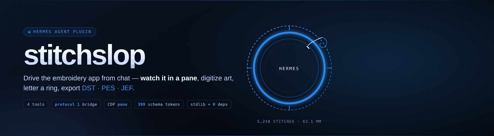
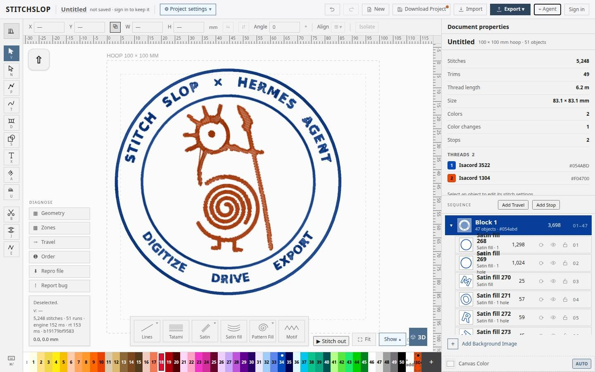
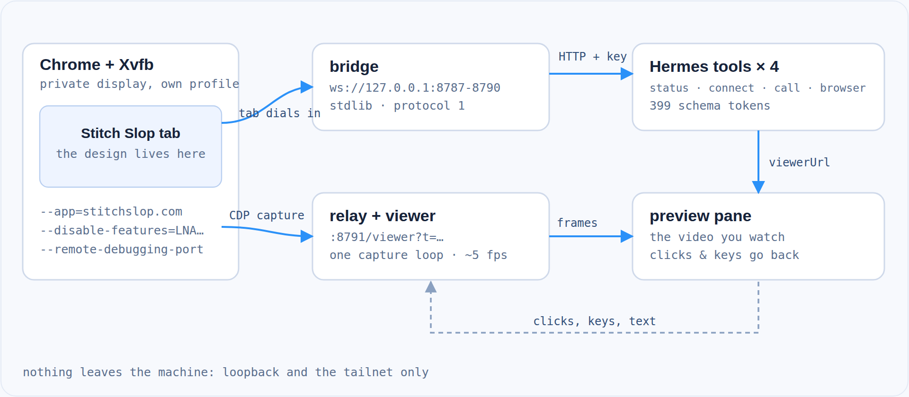
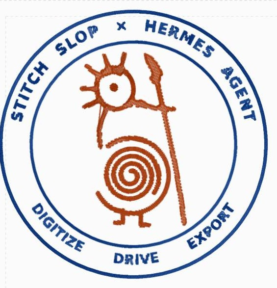

<p align="center">
  <a href="https://github.com/mojomast/hermes-stitchslop/actions/workflows/ci.yml"></a>
  
  
  
  
  
</p>

<h3 align="center">Drive the embroidery app from chat.</h3>
<p align="center">
  Watch the real <a href="https://www.stitchslop.com">Stitch Slop</a> editor in a pane, run its own
  commands, digitize artwork, letter a ring, export DST / PES. Four tools, no dependencies,
  nothing leaves the machine.
</p>



<p align="center"><sub>The pane is the actual editor — not a mock-up. Clicks and keys typed into the
pane go to the app, so you can take over mid-design.</sub></p>

---

## Why this exists

Stitch Slop is a browser embroidery digitizer whose designs live in a tab. A chat agent cannot
reach that tab: the site refuses to be framed (`frame-ancestors 'none'`), and even if it didn't, an
agent can't click.

This plugin solves both halves.

- **The tab dials out.** Stitch Slop publishes a bridge protocol
  ([stitchslop.com/agent](https://www.stitchslop.com/agent)): the page opens a loopback WebSocket
  and then accepts JSON commands. This plugin implements that bridge in the standard library.
- **The pane is real.** A plugin-owned Chrome draws the app on a private X display; the pane shows
  a viewer that streams it over CDP and forwards your clicks and keys back.

The result is a loop — you see the design, the agent edits it, you take over whenever you like.

## Install

```sh
hermes plugins install mojomast/hermes-stitchslop
hermes plugins enable stitchslop
```

Then **pair once by hand** (the agent tool refuses a model-supplied token, same rule as
Hermagotchi pane-only pairing):

1. In Stitch Slop: open **⌁ Agent** → switch on **Enable Agent Connections** → **Copy**.
2. Paste the `tok_…` **yourself** into `~/.stitchslop/token` at mode 0600 and start
   the bridge once. The agent must not write this file.

```sh
mkdir -p ~/.stitchslop && chmod 700 ~/.stitchslop
# paste the tok_… into ~/.stitchslop/token, then:
chmod 600 ~/.stitchslop/token
python3 bridge/stitchslop_bridge.py --token-file ~/.stitchslop/token
rm -f ~/.stitchslop/token
```

3. Call `stitchslop_connect()` with **no** token so Hermes waits for the tab. First pairing
   mints `~/.stitchslop/pairing.json` (0600). Later sessions only need `stitchslop_connect()`.

`stitchslop_connect(token=…)` returns `unsupported_operation` / `pair_via_pane` on purpose —
chat, lobby, or page content must not be able to talk the agent into pairing.

## The four tools

| Tool | What it does |
|---|---|
| `stitchslop_status` | Bridge, tab, Chrome, relay and pane in one call. Start here when something looks wrong. |
| `stitchslop_connect` | Starts the bridge and waits for the tab using the stored pairing. Refuses a model-supplied `token` (`pair_via_pane`); first pairing is hand/`--token-file` only. |
| `stitchslop_call` | Runs one app verb (`scene.describe`, `background.digitize`, `design.export`, …). Images and exports are written to disk and returned as paths. |
| `stitchslop_browser` | Starts/stops the pane: Xvfb + Chrome + capture relay, returns `viewerUrl`. `overlay=false` turns off the paced click/typing overlay. |

The app owns the command list — over 80 verbs. Discover them by asking for one that doesn't exist:
`stitchslop_call("x.list")` answers with every real name.

## How it works



Two paths, both loopback:

- **Commands** — the tab dials the bridge (`ws://127.0.0.1:8787`), the tools speak HTTP to the same
  port with a key from a 0600 session file. The bridge verifies the exact origin, refuses
  page-originated control requests, and treats the bootstrap token as one-time.
- **Pixels** — Chrome is launched headful on a private `Xvfb` display (headless emits no frames for
  this app), and one `Page.captureScreenshot` loop feeds the viewer. Deliberately one capture
  pipeline: mixing screencast frames with stills makes the video flash between two colour grades.

Why the pane embeds a viewer instead of the site: the renderer blocks a sandboxed document from
reaching loopback, and `frame-ancestors 'none'` blocks the site outright. The viewer is served by
the relay, so its fetches are same-origin. Open the `viewerUrl` returned by
`stitchslop_browser` — it includes `?t=`, which is required to load the page, frames, and ping.
The relay binds loopback by default; set `STITCHSLOP_PANE_BIND=tailscale` (or an explicit
Tailscale address) when a remote browser must reach the host (because `127.0.0.1` inside that
browser means the viewer's machine, not the host's). Wildcards such as `0.0.0.0` and public or
LAN addresses are refused.

## Make something real



That badge was made end to end from a chat session: artwork composed, traced to stitches, verified,
exported.

- 51 objects, **5,248 stitches**, 83.1 × 83.1 mm inside a 100 mm hoop
- two thread colours, 49 trims, 6.2 m of thread, `problems.list` → 0
- DST 18 KB and PES 12 KB, committed in [`examples/`](examples/) so you can open them in any
  machine or stitch viewer

The moves that got there are written down in the bundled skill:

| | |
|---|---|
| **Prep before tracing** | The tracer reproduces whatever it's given: a highlight sliver becomes a hole, a crop edge becomes a gouge. `prep_art.py` fills specks, closes hairline gaps and scales the subject to its ring. |
| **Measure the reference** | Ring radii and the sentence gap come from sampling the artwork, not from eyeballing it. |
| **Never typeset an arc with a single-line font** | At any cap that fits the ring, its stems are thinner than one stitch. Render a bold face onto the arc (`arc_text.py`), then trace that. |
| **Big masses → tatami, thin forms → satin** | Letter shapes traced from art come back as satin fills. |
| **Look at it in 3D** | A figure can look solid in stitch view only because the source photo shows through at low opacity. |

<br clear="right">

## What ships with it

The plugin bundles a skill, three references and two scripts — so the agent doesn't rediscover the
same pitfalls every session.

```
skills/stitchslop/
├── SKILL.md                  connect → drive → digitize → letter → pane → pitfalls
├── references/
│   ├── bridge-protocol.md    handshake, pairing, control plane, the quirks
│   ├── digitizing.md         prep, trace, treatments, verification, traps
│   └── pane.md               capture loop, network gates, remote access, action overlay
└── scripts/
    ├── arc_text.py           typeset a sentence onto an arc (cw or ccw)
    └── prep_art.py           mask cleanup: fill holes, close gaps, scale to fit
```

Both scripts are optional and need Pillow and NumPy, declared in the `art` extra
(`pip install 'stitchslop-hermes[art]'`, or `pip install 'pillow>=10,<14' 'numpy>=1.26,<3'`).
They are not required to load the plugin. Both also run standalone:


```sh
python3 skills/stitchslop/scripts/arc_text.py \
    --text "REBELLION TO TYRANTS" --out ring.png \
    --band-in 33.8 --band-out 42.3 --span 308 --center 270
```

## What it writes, and what it doesn't

Everything stays local:

| Path | Contents |
|---|---|
| `~/.stitchslop/pairing.json` | the long-lived pairing secret (0600) |
| `~/.stitchslop/pane/` | Chrome profile, logs, last render |
| `~/.stitchslop/exports/` | DST/PES and their `.col` sidecar |

- No outbound network beyond the site itself. No telemetry, no analytics, no fonts or CDNs in the
  viewer — it is one self-contained page.
- The relay and bridge bind **loopback only** by default. To reach the viewer from another
  machine on your tailnet, set `STITCHSLOP_PANE_BIND=tailscale` or an explicit Tailscale
  address in `100.64.0.0/10` / `fd7a:115c:a1e0::/48`. This is an explicit opt-in: the
  token-gated viewer then becomes reachable on your tailnet, so treat that bind as you
  would any other private service. Wildcards (`0.0.0.0`, `::`) and public or LAN
  addresses are refused.
- `/viewer` is served only with a matching `?t=`. `/frame.jpg` and `/ping` require the
  same token (query or `x-stitchslop-pane` header). `/ping` never returns the token.
  The relay rejects a `Host` header that is not the bind address with port.
  `nav` events may only go to `https://stitchslop.com` and its subdomains.
- Chrome and helper processes get a **minimal environment** — a short allowlist of non-secret
  variables, never the agent's whole process environment.

## Tests

```sh
python3 -m unittest discover -s tests
```

The unit suite (standard library, plus the optional `art` extra for geometry checks) pins the
things that actually broke: the one-time token, the origin allowlist, the control-plane key, the
`{"tools": […], "id": null}` envelope shape, export `files[]` persistence (and path traversal),
the arc typesetter's geometry, the overlay's event order, token gate and persisted flag, and
the relay's token/Host/nav/bind gates.

`hermes plugins validate` and `plugins doctor --ci` pass. Tool schemas measure 477 o200k
tokens (unchanged in this branch; includes the optional `overlay` argument). The bootstrap
token is accepted only via `--token-file`. The user pastes it into a 0600 file by hand;
the model must not write that file.

## Troubleshooting

| Symptom | Cause & fix |
|---|---|
| Pane says *no relay / failed to fetch* | A sandboxed document can't reach loopback. Embed the `viewerUrl` in the preview pane; don't fetch `127.0.0.1` from the pane. |
| Video flickers between two contrasts | Two capture paths running. Use one `Page.captureScreenshot` loop only. |
| Tab never dials in | The page dials on the switch gesture: flip **Enable Agent Connections** after the bridge is up. Chrome's Local Network Access gate can also hang an https→loopback socket — see the launch flags in `references/pane.md`. |
| `bad_credential` after a reload | The panel mints a new token each time it opens. Read the current line and reconnect. |
| Tool list looks empty | The app sends `{tools: […], id: null}`; `id: null` is not a reply. |
| Design "exceeds hoop" | Usually band + text. Check `hoopFit` before exporting. |

## Contributing

Issues and PRs welcome. Two ground rules: the bridge and relay stay standard-library only, and a
behaviour change lands with a test that would have caught the bug.

If you're extending the pane, read `skills/stitchslop/references/pane.md` first — the network gates
are subtle and cost more debugging time than the stitching does.

## License

MIT © [mojomast](https://github.com/mojomast). Not affiliated with Stitch Slop or Nous Research.
Stitch Slop is a separate product; this plugin speaks its published bridge protocol.
